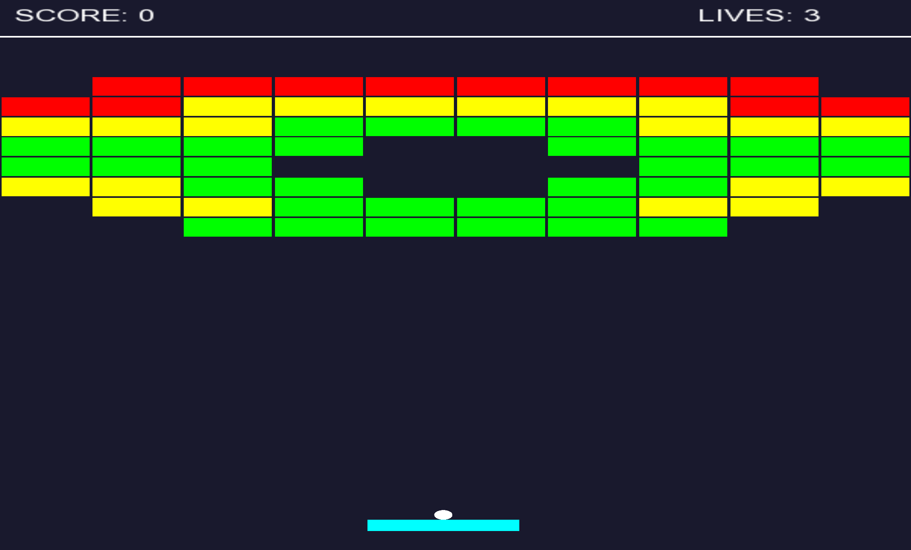

# Block Buster

A brick breaker game in C++ with SFML 3, made for CS1002 Programming Fundamentals (Fall 2026).

## Team

| Name | Roll no. |
|---|---|
| AYESHA AFZAAL | 26L-0021 |
| MARYAM RASHID | 26L-0006 |
| KHADIJA RASHID | 26L-0017 |

## Controls

| Key | What it does |
|---|---|
| Left / A | Move the paddle left |
| Right / D | Move the paddle right |
| Space | Launch the ball |
| Esc | Save the game and go back to the menu |
| Up / Down | Choose a menu option |
| Enter | Select a menu option / go back to the menu after the game ends |

## How to run

1. Open the project in Visual Studio (with SFML 3.0.2 set up).
2. Make sure `level.txt` and the font file (`arial.ttf`) are in the project folder.
3. Build and run (Ctrl + F5).

## Screenshot

